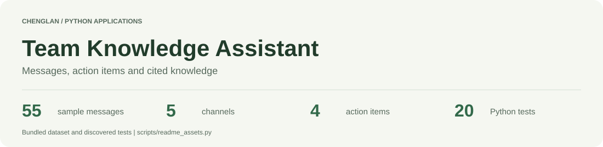
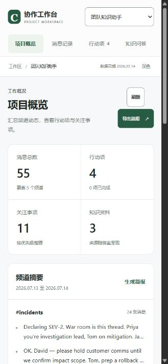
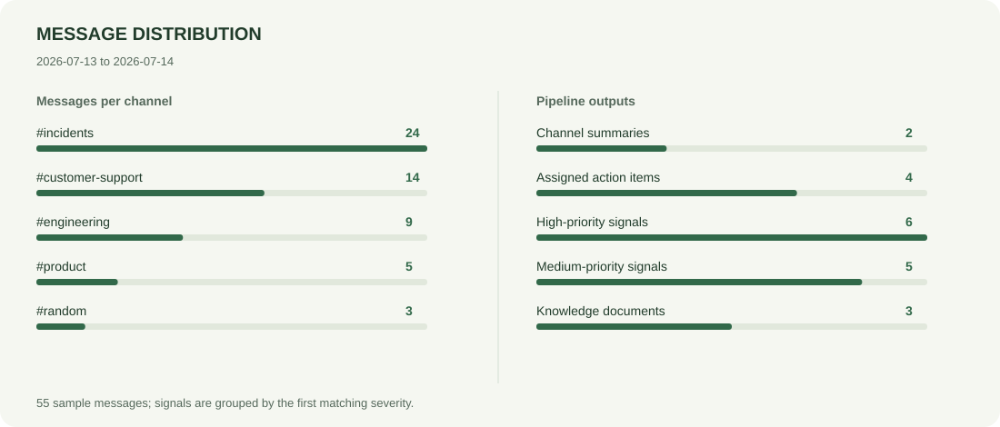
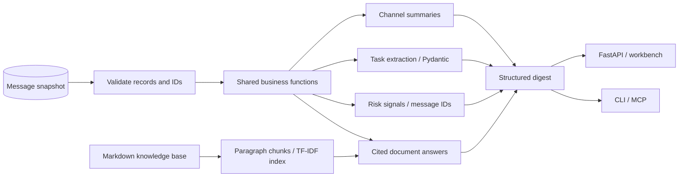
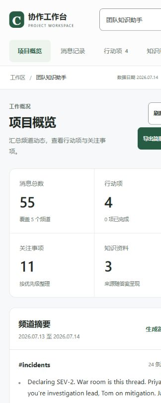

<picture>
  <source media="(prefers-color-scheme: dark)" srcset="docs/assets/header-dark.svg">
  
</picture>

<p align="center"><strong>English</strong> · <a href="README.zh-CN.md">简体中文</a> · <a href="#run-locally">Run locally</a> · <a href="#architecture">Architecture</a> · <a href="specs/README.md">Specifications</a></p>
<p align="center">
  <a href="https://github.com/CatAlvin/Team-Knowledge-Assistant/actions/workflows/ci.yml"></a>
  
  
  
</p>

Team Knowledge Assistant turns engineering messages into channel summaries, assigned action items and traceable risk signals. Its workbench connects those results to message search and document Q&A, so a reviewer can move from a summary to the underlying conversation or source document.



## Follow a complete work session

The bundled payment-service scenario spans 55 messages across 5 channels. The pipeline produces 2 channel summaries, 4 action items and 11 keyword-based signals, each linked to a message ID. Three knowledge documents provide 8 searchable chunks.

<picture>
  <source media="(prefers-color-scheme: dark)" srcset="docs/assets/snapshot-dark.svg">
  
</picture>

| In the workbench | Follow the result |
| --- | --- |
| Search `webhook` in `#customer-support` | 2 messages with full conversation text |
| Mark an action item complete | The filtered list and completion count update; the state survives a refresh |
| Ask `Are webhooks signed?` | Read the signing procedure and open `faq_webhooks.md` |
| Generate and export a brief | Inspect summaries, tasks, alerts and the browser's `review_state` |

[Dataset details](DATA.md) describe the scenario. Figures and [metrics](docs/assets/metrics.json) are generated from the bundled files by [`scripts/readme_assets.py`](scripts/readme_assets.py).

## Run locally

```bash
git clone https://github.com/CatAlvin/Team-Knowledge-Assistant.git
cd Team-Knowledge-Assistant
python -m venv .venv
source .venv/bin/activate
python -m pip install -r requirements.txt
python -m uvicorn api:app --host 127.0.0.1 --port 8001
```

Open **http://127.0.0.1:8001** for the workbench and **http://127.0.0.1:8001/docs** for the API. On Windows PowerShell, activate the environment with `.\.venv\Scripts\Activate.ps1`. Verification uses Python 3.12.

The default `APP_MODE=offline` uses deterministic excerpts, task extraction and document retrieval. For model-generated summaries and answers, install `requirements-live.txt`, copy `.env.example` to `.env`, set `APP_MODE=live` and configure an OpenAI, Anthropic or DeepSeek key.

```bash
python demo.py                 # Writes outputs/digest.json
python scripts/verify.py       # Tests, schema checks and CLI demo
python scripts/smoke_http.py   # Starts and exercises a real HTTP service
```

## Architecture



[`common/assistant.py`](common/assistant.py) composes the digest. HTTP routes, the CLI and four MCP tools call the same operations. [`models.py`](models.py) defines the messages, tasks, alerts and answers that cross those entry points.

### Action items become typed records

Each task carries `task`, `owner`, `due` and `priority`. The extractor validates the entire JSON result against `list[Task]`; the due date is parsed as a date and priority must be `high`, `medium` or `low`. Invalid output becomes an explicit processing error, preserving the distinction between a failed extraction and an empty task list.

A task extracted from the bundled messages:

```json
{
  "task": "add connection-pool saturation alert (warn at 70%, page at 90%)",
  "owner": "tom",
  "due": "2026-07-17",
  "priority": "high"
}
```

The offline parser derives the year from the source message timestamp. The web UI stores completion separately, keyed by task content, owner and due date, and includes that state in exported briefs.

### Answers lead back to documents

The retriever merges adjacent paragraphs, builds TF-IDF vectors and ranks chunks by cosine similarity. A minimum score of 0.05 plus shared content words selects the context passed to the answer step. Responses retain `filename#chunk` references, so the UI can open the document that supports the answer.

```sequenceDiagram
    actor Reader
    participant UI as Workbench
    participant API as FastAPI
    participant Index as Cached TF-IDF index
    participant Answer as Answer operation
    Reader->>UI: Are webhooks signed?
    UI->>API: POST /workspace/ask
    API->>Index: Rank relevant chunks
    Index-->>API: Text, score and source IDs
    API->>Answer: Question + selected context
    Answer-->>UI: Answer + sources
    Reader->>UI: Open source
    UI->>API: GET /workspace/documents/faq_webhooks.md
    API-->>Reader: Document with headings and code
```

The index cache is keyed by the knowledge-directory path. Risk signals preserve the matched terms and message ID; higher-priority matches take precedence, keeping each message in one severity group.

## Interfaces

| Entry point | Operations |
| --- | --- |
| Web workbench | Overview, message filters, task completion, Q&A, source reader and JSON export |
| REST | `/alerts`, `/tasks`, `/summarize`, `/ask`, `/digest` |
| MCP over stdio | `scan_risks`, `summarize_channel`, `extract_action_items`, `ask_kb` |
| CLI | `demo.py` writes a structured digest |

Run `python mcp_server.py` to expose the MCP tools. The [API contract](specs/api-spec.yaml) includes HTTP request schemas and all four MCP tool definitions.

```bash
curl http://127.0.0.1:8001/ask \
  -H "Content-Type: application/json" \
  -d '{"question":"Are webhooks signed?","k":2}'
```

<details>
<summary>Mobile workbench</summary>
<br>

</details>

## Verification and specifications

The suite contains **20 Python tests**: 9 business tests, 5 API tests, 5 workbench tests and 1 MCP subprocess integration test. The HTTP smoke test starts a temporary server, requests a digest, checks citations and verifies the workbench endpoints.

| Check | Evidence |
| --- | --- |
| Duplicate IDs, malformed records and task dates | [`test_business.py`](tests/test_business.py) |
| Invalid model output and digest consistency | [`test_business.py`](tests/test_business.py), [`test_api.py`](tests/test_api.py) |
| Cached indexes stay associated with their directory | [`test_business.py`](tests/test_business.py) |
| Message views, document paths and question validation | [`test_workbench.py`](tests/test_workbench.py) |
| HTTP and MCP schemas match the implementation | [`scripts/contracts.py`](scripts/contracts.py) |
| README figures match the sample | `python scripts/readme_assets.py --check` |

The [CI workflow](.github/workflows/ci.yml) runs verification on Ubuntu and Windows with Python 3.12. Requirements, design decisions, data models and acceptance tasks are linked in [`specs/`](specs/README.md). [The workbench specification](specs/workbench.md) connects UI behavior to its API and verification criteria.

<p align="center"><a href="DEMO.md">Demo walkthrough</a> · <a href="specs/design.md">Design decisions</a> · <a href="docs/verification.md">Verification record</a> · <a href="README.zh-CN.md">中文说明</a></p>

