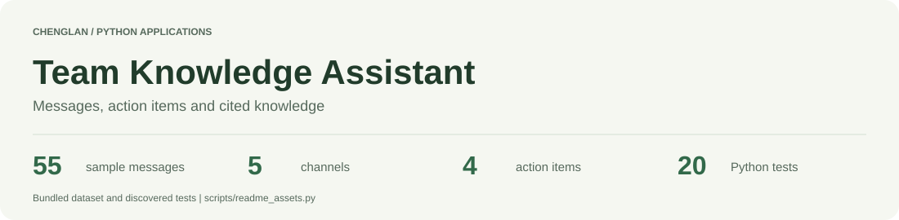
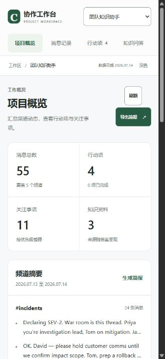
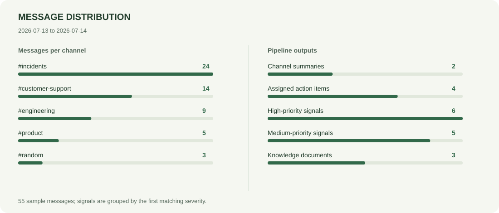
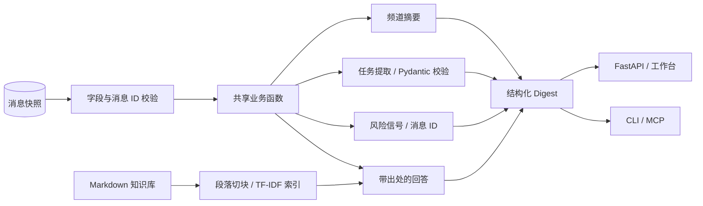
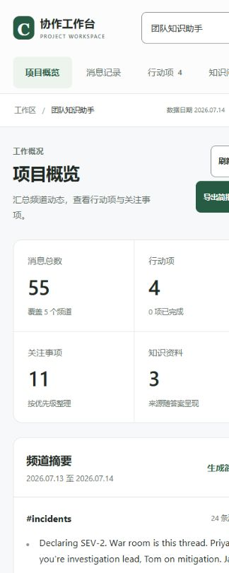

<picture>
  <source media="(prefers-color-scheme: dark)" srcset="docs/assets/header-dark.svg">
  
</picture>

<p align="center"><a href="README.md">English</a> · <strong>简体中文</strong> · <a href="#本地运行">本地运行</a> · <a href="#系统结构">系统结构</a> · <a href="specs/README.md">项目规格</a></p>
<p align="center">
  <a href="https://github.com/CatAlvin/Team-Knowledge-Assistant/actions/workflows/ci.yml"></a>
  
  
  
</p>

团队知识助手将工程协作消息整理为频道摘要、带负责人的行动项和可追溯的风险信号。工作台把这些结果与消息检索、文档问答连接起来，阅读摘要后可以继续查看原始对话或知识来源。



## 从一次完整协作过程开始

内置的支付服务场景包含 5 个频道、55 条消息。处理流程生成 2 份频道摘要、4 项行动项和 11 条关键词风险信号，每条信号保留消息 ID。知识库包含 3 份文档，拆分为 8 个检索片段。

<picture>
  <source media="(prefers-color-scheme: dark)" srcset="docs/assets/snapshot-dark.svg">
  
</picture>

| 工作台操作 | 可以追踪的结果 |
| --- | --- |
| 在 `#customer-support` 中搜索 `webhook` | 2 条匹配消息，可展开阅读原文 |
| 将行动项标为完成 | 完成数与筛选列表同步变化，刷新后保留状态 |
| 提问 `Are webhooks signed?` | 查看签名流程，并打开 `faq_webhooks.md` |
| 生成并导出简报 | 检查摘要、任务、提醒与当前浏览器的 `review_state` |

[数据说明](DATA.md)记录了场景内容。图表和[指标文件](docs/assets/metrics.json)由 [`scripts/readme_assets.py`](scripts/readme_assets.py) 读取内置数据生成。

## 本地运行

```bash
git clone https://github.com/CatAlvin/Team-Knowledge-Assistant.git
cd Team-Knowledge-Assistant
python -m venv .venv
source .venv/bin/activate
python -m pip install -r requirements.txt
python -m uvicorn api:app --host 127.0.0.1 --port 8001
```

打开 **http://127.0.0.1:8001** 进入工作台，**http://127.0.0.1:8001/docs** 查看接口。在 Windows PowerShell 中，使用 `.\.venv\Scripts\Activate.ps1` 激活环境。验证工作流使用 Python 3.12。

默认 `APP_MODE=offline`，使用确定性的文本摘录、任务提取和文档检索。需要模型生成摘要和回答时，安装 `requirements-live.txt`，将 `.env.example` 复制为 `.env`，设置 `APP_MODE=live` 并配置 OpenAI、Anthropic 或 DeepSeek 密钥。

```bash
python demo.py                 # 输出 outputs/digest.json
python scripts/verify.py       # 测试、契约检查与 CLI 演示
python scripts/smoke_http.py   # 启动并验证实际 HTTP 服务
```

## 系统结构



[`common/assistant.py`](common/assistant.py)负责组合简报。HTTP、CLI 和 4 个 MCP 工具复用相同的业务操作；[`models.py`](models.py)定义跨入口使用的消息、任务、提醒和回答结构。

### 将行动项整理为结构化记录

每项任务包含 `task`、`owner`、`due` 和 `priority`。提取器用 `list[Task]` 校验整个 JSON 结果，日期按日期类型解析，优先级限定为 `high`、`medium` 或 `low`。输出不合规时返回明确的处理错误，调用方可以区分提取失败与没有任务。

下面是一条从内置消息提取出的任务：

```json
{
  "task": "add connection-pool saturation alert (warn at 70%, page at 90%)",
  "owner": "tom",
  "due": "2026-07-17",
  "priority": "high"
}
```

离线解析器从原消息时间中取得年份。页面另外保存完成状态，以任务内容、负责人和截止日期作为键，并将该状态写入导出的简报。

### 从回答继续读到原文

检索器合并相邻段落，构建 TF-IDF 向量，并按余弦相似度排序。最高分达到 0.05 且与问题存在有效内容词重叠时，对应片段进入回答步骤。结果保留 `文件名#片段编号`，页面可据此打开支撑回答的文档。

```sequenceDiagram
    actor Reader as 使用者
    participant UI as 工作台
    participant API as FastAPI
    participant Index as 缓存的 TF-IDF 索引
    participant Answer as 回答函数
    Reader->>UI: Are webhooks signed?
    UI->>API: POST /workspace/ask
    API->>Index: 检索并排序片段
    Index-->>API: 正文、分数和来源编号
    API->>Answer: 问题与选定上下文
    Answer-->>UI: 回答与来源
    Reader->>UI: 打开来源
    UI->>API: GET /workspace/documents/faq_webhooks.md
    API-->>Reader: 带标题与代码排版的文档
```

索引缓存以知识库目录路径为键，避免不同目录之间混用索引。风险信号保留命中词和消息 ID；同一条消息优先归入更高等级，便于按优先级阅读。

## 运行入口

| 入口 | 操作 |
| --- | --- |
| Web 工作台 | 概览、消息筛选、任务完成、问答、来源阅读和 JSON 导出 |
| REST | `/alerts`、`/tasks`、`/summarize`、`/ask`、`/digest` |
| stdio MCP | `scan_risks`、`summarize_channel`、`extract_action_items`、`ask_kb` |
| CLI | `demo.py` 输出结构化简报 |

执行 `python mcp_server.py` 启动 MCP 服务。[接口契约](specs/api-spec.yaml)包含 HTTP 请求结构和全部 4 个 MCP 工具定义。

```bash
curl http://127.0.0.1:8001/ask \
  -H "Content-Type: application/json" \
  -d '{"question":"Are webhooks signed?","k":2}'
```

<details>
<summary>手机工作台</summary>
<br>

</details>

## 验证与规格

项目共有 **20 项 Python 测试**：9 项业务测试、5 项 API 测试、5 项工作台测试、1 项 MCP 子进程集成测试。HTTP 检查脚本会启动临时服务，请求完整简报，检查引用来源并验证工作台接口。

| 检查内容 | 对应实现 |
| --- | --- |
| 重复 ID、畸形记录与任务日期 | [`test_business.py`](tests/test_business.py) |
| 模型输出校验、简报与单项结果一致性 | [`test_business.py`](tests/test_business.py)、[`test_api.py`](tests/test_api.py) |
| 不同知识目录对应独立缓存 | [`test_business.py`](tests/test_business.py) |
| 消息页面、来源路径和问题参数 | [`test_workbench.py`](tests/test_workbench.py) |
| HTTP 与 MCP 契约一致性 | [`scripts/contracts.py`](scripts/contracts.py) |
| README 图表与数据一致性 | `python scripts/readme_assets.py --check` |

[CI 工作流](.github/workflows/ci.yml)在 Ubuntu 和 Windows 上使用 Python 3.12 验证。需求、设计决策、数据模型和验收任务集中在 [`specs/`](specs/README.md)。[工作台规格](specs/workbench.md)将页面行为与接口、验收条件对应起来。

<p align="center"><a href="DEMO.md">演示步骤</a> · <a href="specs/design.md">设计决策</a> · <a href="docs/verification.md">验证记录</a> · <a href="README.md">English</a></p>

