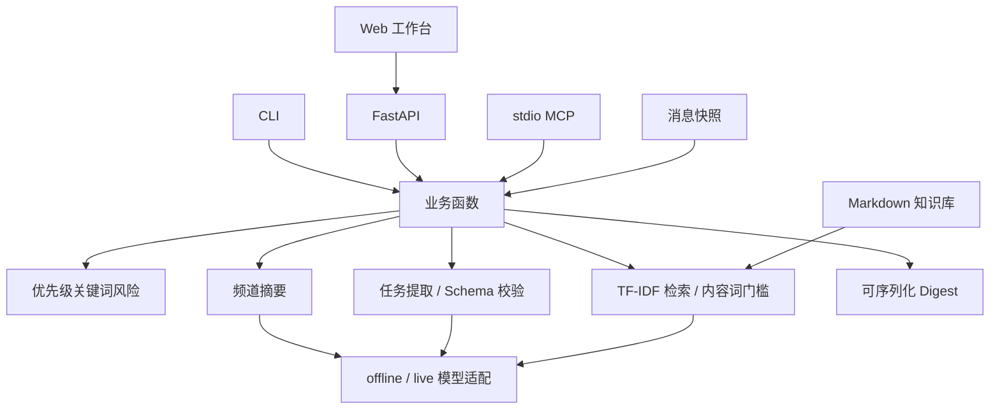

# 架构设计

## ADR-001：同步接口与业务复用

REST 和 MCP 直接调用 common.assistant；CLI 将 Digest 输出到本地 JSON。当前数据规模适合单进程同步调用，不引入仅存内存但对外承诺可靠性的异步任务队列。后续需要长任务时再引入持久化队列。

## ADR-002：任务输出先校验

Pydantic Task 约束 task、owner、due、priority。JSON 解析或 Schema 校验失败抛出错误；HTTP 返回通用 502，不返回模型原始异常。离线规则从消息时间取得年份，不固定为某一年。

## ADR-003：检索门槛与路径缓存

段落切块、TF-IDF 余弦检索。最高分至少 0.05 且与问题存在非停用内容词重叠才进入回答。来源用 文件名#片段编号 表示。索引按绝对目录缓存，文件更新后需重启；上限 8 个目录。

## ADR-004：离线优先

offline 为默认模式，即使已有供应商密钥也不会联网。live 必须显式启用并配置密钥。文本生成只接受上下文材料，风险规则无需模型。样例消息保留原始字段 sim_ts，它在业务中表示消息时间。

## 数据与运行边界

前端通过 /workspace 适配统一展示数据，根路径与静态资源由同一 FastAPI 提供。首页使用确定性提取，生成简报与问答按用户操作执行。任务完成标记存于浏览器并随 JSON 导出。界面使用原生 JavaScript、原生 dialog 与响应式 CSS；详见 [workbench.md](workbench.md)。

消息来自项目 data/，知识库来自 kb/，读取路径不依赖当前工作目录。API 不接受任意服务器文件路径，不执行源消息中的指令。HTTP 可用 SERVICE_API_KEY 保护业务接口，健康检查保持公开。MCP stdout 专用于协议。
